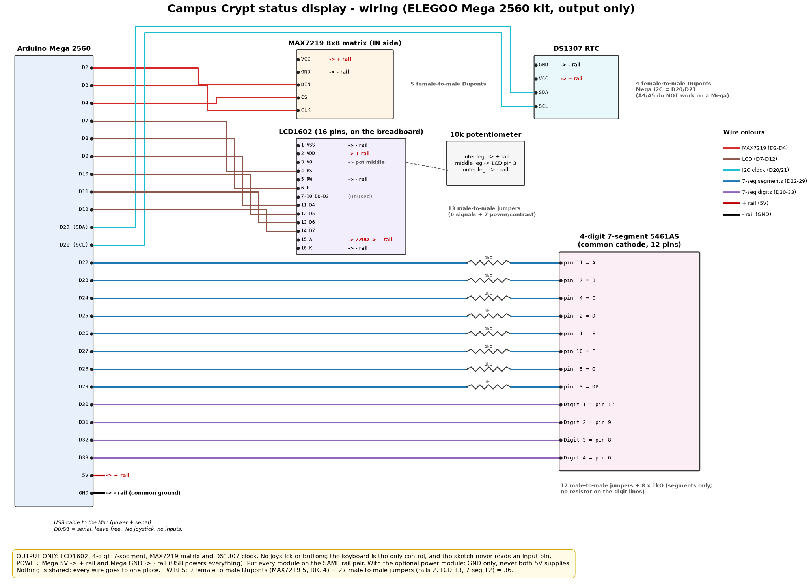

# Wiring the Campus Crypt status display (ELEGOO Mega 2560 kit, output only)



*(The diagram is drawn by `hardware/tools/make_wiring_diagram.py`. Run it again if you change anything.)*

This build is **output only**: an LCD1602, the bare 4-digit 7-segment display, the MAX7219 8x8 matrix and the DS1307 clock. There is **no joystick or button**; the keyboard is the only control. Nothing on the board is read as an input, so a loose or unconnected pin can never act as a key press.

Every module gets its own Mega pins (nothing is shared), so each wire goes to exactly one place. **Unplug USB while you wire.**

## 0. Before you start

### Parts used

| Part | Count |
|---|---|
| Arduino Mega 2560 + USB cable | 1 |
| 830-hole breadboard | 1 |
| LCD1602 (16-pin, the parallel type with no I2C board on the back) | 1 |
| 10kΩ potentiometer (contrast) | 1 |
| 4-digit 7-segment display, 12 pins, **5461AS** (common cathode) | 1 |
| MAX7219 8x8 LED matrix module | 1 |
| DS1307 RTC module (with its coin cell) | 1 |
| **1kΩ** resistors | 8 (segments) |
| 220Ω resistor | 1 (LCD backlight) |
| Female-to-male Dupont wires | **9** (MAX7219 ×5, DS1307 ×4) |
| Male-to-male breadboard jumpers | **27** (rails 2, LCD 13, 7-segment 12) |

**Wire count: 36 in total (9 female-to-male + 27 male-to-male).** That fits the kit's ~20 female-to-male Duponts with 11 to spare. The 27 male-to-male runs (breadboard to Mega header, both ends need a male pin) come from the kit's breadboard jumper set. Two ways to save wires are in the notes at the end (down to 33).

No 74HC595 and no joystick are used any more: the Mega has enough pins to drive the 7-segment display directly, which removes the chip and its 13 wires.

### Power

Everything runs from the Mega's USB power:

1. **Mega 5V → breadboard + rail** (1 jumper).
2. **Mega GND → breadboard – rail** (1 jumper).

Use **one** rail pair (one long edge) for every module so you don't need bridge wires. At the sketch's matrix brightness (3 of 15) the whole build draws well under 200 mA, which USB supplies easily.

*Using the breadboard power module instead (optional):* plug it onto the rails, set its jumper to **5V**, connect **Mega GND to the – rail** and **leave Mega 5V unconnected** (two 5V supplies must never be joined). Switch the module on before or together with USB.

## 1. Full pin map (Mega side)

| Mega pin | Goes to | Notes |
|---|---|---|
| D0, D1 | – | USB serial to the Mac. **Leave free.** |
| D2 | MAX7219 DIN | |
| D3 | MAX7219 CLK | |
| D4 | MAX7219 CS (also labelled LOAD) | |
| D7 | LCD pin 4 (RS) | |
| D8 | LCD pin 6 (E) | |
| D9, D10, D11, D12 | LCD pins 11, 12, 13, 14 (D4–D7) | |
| D20 (SDA) | DS1307 SDA | the Mega's I2C pins are **20/21**, not A4/A5 |
| D21 (SCL) | DS1307 SCL | |
| D22 … D29 | 7-segment A, B, C, D, E, F, G, DP via 1kΩ each | the double header at the end of the board |
| D30, D31, D32, D33 | 7-segment Digit 1 … Digit 4 (pins 12, 9, 8, 6) | no resistors on these |
| 5V | + rail | |
| GND | – rail | **required** |

Nothing else is connected. A0–A15 are free (the old joystick pins are gone).

## 2. 4-digit 7-segment display (5461AS, 12 pins)

### Finding pin 1

Hold the display with the digits facing you, the decimal points at the **bottom** and the pins pointing away from you.

* The **bottom row** of pins is **1 to 6**, counted left to right.
* The **top row** is **7 to 12**, counted right to left. Pin 12 is the top-left pin and sits above pin 1.

```
      12  11  10   9   8   7        <- top row (pin 12 at top-left)
   +----------------------------+
   |  8.   8.   8.   8.         |   digits: D1  D2  D3  D4
   +----------------------------+
       1   2   3   4   5   6        <- bottom row (pin 1 at bottom-left)
```

Put it across the breadboard's centre gap so the two rows of pins land in different columns.

### Wiring

| Display pin | Function | Connect to |
|---|---|---|
| 11 | segment A | 1kΩ → Mega D22 |
| 7 | segment B | 1kΩ → Mega D23 |
| 4 | segment C | 1kΩ → Mega D24 |
| 2 | segment D | 1kΩ → Mega D25 |
| 1 | segment E | 1kΩ → Mega D26 |
| 10 | segment F | 1kΩ → Mega D27 |
| 5 | segment G | 1kΩ → Mega D28 |
| 3 | DP (decimal point, used as the clock colon) | 1kΩ → Mega D29 |
| 12 | **Digit 1** common (leftmost) | Mega D30 |
| 9 | **Digit 2** common | Mega D31 |
| 8 | **Digit 3** common | Mega D32 |
| 6 | **Digit 4** common (rightmost) | Mega D33 |

For each segment: put the resistor from the display pin's column to an empty column, then run a jumper from that empty column to the Mega. Digits go straight to the Mega with a jumper.

It is **common cathode**: the sketch drives a digit pin LOW to turn it on and a segment pin HIGH to light it.

> **Why 1kΩ:** each lit segment draws about 3 mA, so a digit showing "8." pulls about 24 mA into one Mega pin, inside the 40 mA limit. With 220Ω it would be ~80 mA, which over-stresses the pin. 1kΩ is a little dimmer but safe to leave running.

## 3. LCD1602 (parallel, 4-bit mode)

Push the LCD's 16 pins into the breadboard along the same edge as the rail pair you're using.

| LCD pin | Name | Connect to |
|---|---|---|
| 1 | VSS | – rail |
| 2 | VDD | + rail |
| 3 | V0 (contrast) | **middle leg of the 10kΩ potentiometer** |
| 4 | RS | Mega D7 |
| 5 | RW | – rail (we only ever write) |
| 6 | E | Mega D8 |
| 7–10 | D0–D3 | nothing (4-bit mode) |
| 11 | D4 | Mega D9 |
| 12 | D5 | Mega D10 |
| 13 | D6 | Mega D11 |
| 14 | D7 | Mega D12 |
| 15 | A (backlight +) | **220Ω** → + rail (the resistor leg goes straight into the rail, no jumper) |
| 16 | K (backlight –) | – rail |

**Contrast potentiometer (10kΩ):** one outer leg to + rail, the other to – rail, the middle leg to LCD pin 3. Turn it until the text is crisp. If the screen is blank, or shows a row of solid blocks, adjust this first.

## 4. MAX7219 8x8 matrix module (5 female-to-male Duponts)

Use the 5-pin header on the **input** side, marked DIN (the DOUT end is for chaining).

| Module pin | Connect to |
|---|---|
| VCC | + rail |
| GND | – rail |
| DIN | Mega D2 |
| CS (or LOAD) | Mega D4 |
| CLK | Mega D3 |

The module has its own current-setting resistor. The sketch runs it at brightness 3 of 15. If images are mirrored or upside down, set `MATRIX_FLIP_X` / `MATRIX_FLIP_Y` to 1 at the top of the sketch.

## 5. DS1307 real-time clock (4 female-to-male Duponts)

| RTC pin | Connect to |
|---|---|
| GND | – rail |
| VCC | + rail |
| SDA | **Mega D20 (SDA)** |
| SCL | **Mega D21 (SCL)** |

On a Mega the I2C pins are **20 and 21** (also repeated, unlabelled-by-number, as SDA/SCL near AREF). A4/A5 are plain analog pins on the Mega and will not work for the clock. Keep the coin cell in so the clock keeps time while unplugged. The first run sets the clock to the sketch's compile time if it isn't already running; with no RTC at all the sketch keeps a rough clock from 12:00.

Some DS1307 boards also have DS, SQ or BAT pins. Leave those unconnected.

## 6. Final checks before plugging in USB

- [ ] Mega 5V → + rail and Mega GND → – rail (or, with the power module: GND only)
- [ ] All modules use the **same** rail pair
- [ ] 7-segment: resistors on the **segment** pins (22–29), **none** on the digit pins (30–33)
- [ ] RTC on **D20/D21**, not A4/A5
- [ ] The LCD backlight has its 220Ω resistor
- [ ] Nothing is plugged into D0/D1 and there is no joystick or button wired

## Saving wires (optional)

* **Fixed contrast instead of the pot (−3 jumpers):** put a ~1kΩ–2.2kΩ resistor from LCD pin 3 straight into the – rail. Most LCD1602s are readable that way; if it's too faint or too dark, try the other value or go back to the pot.
* **Skip the 7-segment display (−12 jumpers, −8 resistors):** the LCD already shows the floor and the clock. The sketch runs fine with it unplugged.
* Totals: **33** wires with only the contrast change; **21** (12 jumpers + 9 Duponts) with both.
